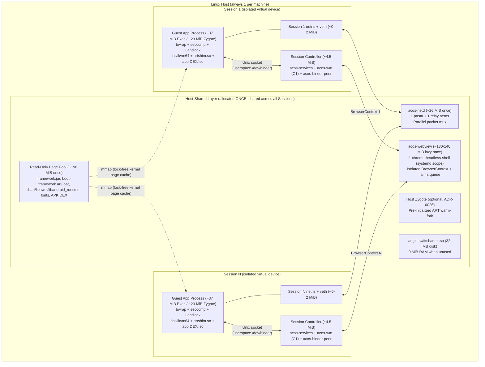

# ACOS Architecture Overview

ACOS runs real Android applications (API 34, x86_64) for AI coding agents on Linux without booting a virtual machine, guest kernel, `init`, `system_server`, or `SurfaceFlinger` per device. This document describes the current architecture: where ACOS cuts into stock AOSP, what is shared once on the **Host** vs isolated per **Session**, how Host-shared services handle parallel Sessions, and how verification stays honest.

See [`glossary.md`](glossary.md) for canonical terms and [`diagrams/aosp-vs-acos-resources.excalidraw`](diagrams/aosp-vs-acos-resources.excalidraw) for the editable visual resource diagram.

---

## 1. The Core Architectural Cut: AOSP vs ACOS

A stock Android emulator boots a full QEMU VM with its own Linux kernel, `init`, `zygote64`, `system_server`, `SurfaceFlinger`, HAL daemons, and kernel `/dev/binder` (~3,300 MiB per VM, ~25 s cold boot, zero memory sharing across VMs).

ACOS keeps **everything inside the app process stock AOSP** and replaces **everything on the other side of `/dev/binder`** with lightweight Rust services running directly on the Linux Host:

| Layer | Stock AOSP Emulator | ACOS |
|---|---|---|
| Kernel & virtualization | Separate QEMU VM + guest Android kernel per device | Shared Linux **Host** kernel + unprivileged `bwrap` namespaces (user/mount/pid/net), seccomp, Landlock |
| App execution | Stock `dalvikvm64` (ART), `framework.jar`, `libandroid_runtime`, `libhwui` (Skia), Bionic `libc`, app `.so` | **Identical stock AOSP binaries** extracted from API-34 system image (`tools/extract-bootclasspath.sh`) |
| Binder IPC | Kernel `/dev/binder` driver | **Userspace `/dev/binder` shim** (`crates/acos-art/shim/artshim.c`, `LD_PRELOAD`) translating `open/ioctl/mmap` over a Unix socket (`acos-binder-peer`) |
| System services (`system_server`, `servicemanager`) | Heavy Java `system_server` + ~100 services per VM | Per-session Rust **Session Controller** (`acos-services`): `core` services + 23 attachable modules (`off` by default) |
| Window compositor (`SurfaceFlinger`) | Full `SurfaceFlinger` + GPU pipeline per VM | C1 software compositor in Rust (`acos-wm`) + `acos-sfgeom` AOSP geometry, CPU Skia (`libhwui`) |
| Network (`netd`, Wi-Fi/radio stack) | Full guest network stack + QEMU SLIRP per VM | **One Host-shared `acos-netd`** (`pasta` + relay netns) multiplexing isolated per-session netns + `veth` |
| WebView (`com.android.webview`) | Heavy per-device Android System WebView renderer (~150–250 MiB/VM) | **One Host-shared `acos-webview`** (`chrome-headless-shell`) serving isolated per-session `BrowserContext`s |
| GLES / GPU | Virtual GPU / SwiftShader per VM | Read-only `angle-swiftshader` `.so` bind-mounted into guest (0 MiB when unused, 100% parallel) |

---

## 2. Four-Layer Ownership & Resource Model

Every component in ACOS belongs to exactly one of four ownership scopes:

1. **Host (1 per Linux machine):** Owns the Linux kernel, shared compiler cache (`sccache`), read-only AOSP image files, and the **Host-Shared Layer**.
2. **Host-Shared Layer (1 instance per Host):** Amortizes heavy read-only pages and heavy helper daemons across all concurrent Sessions.
3. **Session (1 per virtual Android device):** Owns an isolated sandbox (`/data`, namespaces, seccomp/Landlock), one **Session Controller** (`acos-services` + `acos-wm`), attached module state, optional per-session network namespace (`netns` + `veth`), and optional Chromium `BrowserContext`.
4. **Guest App Process (1 Android PID inside a Session):** Starts with the primary target APK process. System apps (`com.android.permissioncontroller`, `com.android.systemui`, `com.android.webview`) and secondary app processes are forked **lazily on demand** (0 MiB until triggered) and reclaimed when idle.

### Resource Bifurcation & Measured RAM

Verified measurements from `DENSITY20` (`results/handoff/DENSITY20/README.md`), `MODULES.md`, `DECISIONS.md`, and `GLSHIP`:

| Component | Scope | Measured / Budgeted Cost | Notes |
|---|---|---|---|
| Read-only AOSP page pool (`framework.jar` 20 MiB, `boot-framework.art/.oat`, fonts 15.4 MiB, `libart`/`libhwui`/`libandroid_runtime`/`libgui`, APK DEX) | **Host-shared (once)** | **~190 MiB once** | Shared via Linux page cache (`shared-fixed` cached boot image, ADR-0026) |
| `acos-netd` relay (`1 pasta` + relay netns) | **Host-shared (once)** | **~26 MiB once** | Flat from N=1 to N=20; started only when `network` module is used |
| `acos-webview` broker (`chrome-headless-shell`) | **Host-shared (lazy once)** | **~130–140 MiB once** | 0 MiB when unused; started on first session connect in its own systemd scope |
| Software GLES (`angle-swiftshader`) | **Host-shared RO `.so`** | **0 MiB RAM when unused** (32 MB disk) | Bind-mounted read-only; loaded into guest only if app opens GLES/EGL |
| Guest App Process private RAM (Exec mode) | **Per-Session** | **~37.0 MiB/session** | Boot-image CoW 10.2, malloc/GC anon 9.8, Dalvik heap 7.1, shared-lib CoW 4.5, odex 3.8 |
| Guest App Process private RAM (Zygote mode) | **Per-Session** | **~23.2 MiB/session** | Warm-fork eliminates ~14 MiB of boot-image + odex CoW |
| Session Controller (`acos` + `acos-art` + `acos-services` + `acos-wm`) | **Per-Session** | **~4.5 MiB/session** | Included in per-session totals below |
| Per-session network (`netns` + `veth` + `dnsproxyd`) | **Per-Session (opt-in)** | **~0–2 MiB/session** | Manifest budget: 2 MiB (`network` module) |
| Per-session WebView (`BrowserContext` + gate socket) | **Per-Session (opt-in)** | **~4 MiB/session** | Manifest budget: 4 MiB (`webview` module; ~32 MiB PSS when actively rendering complex pages) |
| Attachable in-process Rust modules (`accessibility`, `system.permissions`, `system.notifications`, `sensors`, `location`, `net.wifi`, `net.telephony`, `hw.bluetooth`, `hw.biometric`, `media.session`, `feedback.vibrator`) | **Per-Session (opt-in)** | **0 MiB when `off`**, **1–2 MiB** budget each | Pure Rust state inside the Session Controller |
| Lazy system app PIDs (`permissioncontroller`, `systemui`) | **Per-App (lazy)** | **0 MiB until triggered** | Spawned only when permission dialog or notification shade opens |

### Scaling vs Stock AOSP Emulator

| Concurrent Sessions | Stock AOSP Emulator | ACOS (Exec mode) | ACOS (Zygote mode) | Reduction |
|---|---|---|---|---|
| **N = 1** | ~3,300 MiB (25.2 s cold) | **234 MiB** | ~215 MiB | ~14× lighter |
| **N = 10** | ~33,000 MiB | **561 MiB** | **403 MiB** | 59×–82× lighter |
| **N = 20** | ~66,000 MiB (64.5 GiB — OOM on 61 GiB Host) | **935 MiB (0.91 GiB)** | **645 MiB (0.63 GiB)** | **70×–102× lighter** |

---

## 3. Host-Shared Services & Multi-Session Concurrency Model

Sharing heavy services once per Host raises an immediate design question: **when N agents run parallel Sessions against the same Host-shared component, do they execute in parallel or block on a lock?**

The rule across ACOS is: **keep the hot path lock-free and parallel; serialize only where an upstream engine requires it, and bound every serialized section with fairness and preemption.**

| Host-Shared Component | Parallel or Serial? | Isolation Boundary | How Contention Is Handled |
|---|---|---|---|
| **Read-only page pool** (`framework.jar`, `.art/.oat`, `.so`, fonts) | **100% Parallel** | Kernel CoW private mappings | Lock-free Linux page cache. Dirty pages fault privately into each Session's own memory. |
| **Software GLES** (`angle-swiftshader`) | **100% Parallel** | Separate in-process guest memory | No shared daemon at all—each guest process executes its own CPU rasterizer threads. |
| **`acos-netd`** (`pasta` + relay netns, ADR-0030) | **100% Parallel (packet-multiplexed)** | Per-session `netns` + `veth` + netfilter ACLs | Each Session gets its own virtual network interface and `tc`/netfilter state (`offline`, `delay`, `loss`, `hostport` affect only that Session). Packets multiplex concurrently through one `pasta` (~15–18 MB/s aggregate). Host loopback, RFC1918, link-local, and CGNAT are blocked by netfilter rules the guest cannot alter (`no CAP_NET_ADMIN`, `AF_NETLINK` blocked by seccomp). |
| **`acos-webview`** (`chrome-headless-shell`, ADR-0031 + WVFAIR + WVTAIL + WVSCOPE) | **Parallel execution; fair-queued `beginFrame` capture** | Isolated Chromium `BrowserContext` per Session (separate cookies, storage, cache, network profile) | Page loads, JS execution, DOM layout, network requests, and CDP input run **concurrently** across Sessions. Only `IssueExternalBeginFrame` (pixel capture) is serialized because pinned `chrome-headless-shell` crashes on simultaneous `beginFrame` calls across targets. `crates/acos-webview/src/fair.rs` enforces a **fair queue**: 1 frame in flight, **750 ms cap** while another view waits (2 s solo), **1 coalesced pull per view**, **input frames preempt** non-input pulls via `Yield`, and frame pulls run off the connection worker pool so input/JS bridges never stall behind a slow page. Typical capture: **1–8 ms** (fast view stays ~1 ms median even beside a deliberately slow view). |
| **Host Zygote** (ADR-0026) | **Serial `fork()` (~20–50 ms); 100% Parallel afterwards** | Private post-fork `bwrap` sandbox, `/data`, and memory limit | Only the brief `fork()` handoff on launch/reset touches the Zygote; once forked, every child executes completely independently. |

### Critical Traps on Host-Shared Daemons (WVSCOPE / WVTAIL)

1. **Never spawn a Host-shared daemon inside a Session's cgroup.** `setsid` changes process session ID, **not** cgroup—so tearing down one Session's cgroup (`tools/guarded.sh`) would SIGKILL the Host daemon for every other Session. `acos-webview` spawns its broker inside its own transient systemd scope (`systemd-run --user --scope --collect ...`) with idle shutdown.
2. **Version-pin the Host daemon handshake.** A long-lived Host daemon can outlive the branch that compiled it. `acos-webview`'s `attach:2` handshake checks a build fingerprint (`version + git sha + workspace source digest`); on mismatch, a daemon with live sessions is left untouched and the new build binds its own endpoint (`broker-<source8>.sock`).
3. **Never conflate engine restart with unknown view.** If the Host Chromium process restarts, every active view dies; the broker returns `ENGINE_RESTARTED` (never `NO_VIEW`) so callers know to recreate views rather than misdiagnosing a bookkeeping bug.

---

## 4. Attachable Service Modules (ADR-0029)

Every Android system service outside the always-on `core` bundle is an **attachable module** registered in `ModuleRegistry::standard()` (`crates/acos-services/src/module.rs`):

- **Profiles:** `off` (default for optional modules), `stub`, `scripted`, `real`.
- **Attach timing:** `at-launch` (declared at `acos_launch`, e.g., `core`, `network`, `webview`, `net.telephony`) or `hot` (attached/detached live via `acos_services`, e.g., `accessibility`, `system.permissions`, `system.notifications`, `sensors`, `location`, `net.wifi`, `hw.bluetooth`, `hw.biometric`, `media.session`, `feedback.vibrator`).
- **Clean teardown:** Detaching a module leaves zero lingering registrations, threads, fds, or sockets.
- **No silent fakes:** Looking up an unattached service returns either a structured `UNSUPPORTED_ANDROID_API` tombstone naming the module and attach call, or Android's honest missing-service path (`null`) where AOSP handles it natively. Every verdict lists attached modules and profiles; any pass relying on `stub`/`scripted` is labeled explicitly.
- **Multi-process & launch origin (MERGEFIX2):** Primary app launches (`PendingLaunch.origin = Guest`) are materialized by the guest's `ActivityThread`; Host-initiated launches (`PendingLaunch.origin = Host`, such as notification `PendingIntent` taps or permission dialogs) are delivered by the Session Controller (`AmsState::pending_launch_for_tag`) so two `Activity` instances never collide.

The complete generated table of all 24 modules, budgets, and control operations lives in [`../MODULES.md`](../MODULES.md).

---

## 5. Settle, Verification & Confinement Invariants

- **Settle is content-aware, not pixel-only (ADR-0032):**
  - Actions (`tap`, `type`, `key`, `back`, `launch`, `reset`) and pixel assertions (`capture`, `assert_screenshot`, `assert_region`) use `strict` settle by default.
  - `wait_for` and UI-tree assertions (`assert_text`, `assert_visible`, `assert_not_visible`, `assert_state`) default to `auto` (`strict` first, falling back to `content` stability—tree signature unchanged for ~300 ms—on endlessly animating screens, with `pixel_evidence: false` explicitly reported).
  - A timed-out settle is **never** `pass` (always `status: timeout`, `error.code: TIMEOUT`).
  - A `PLACEHOLDER_CONTENT` verdict requires the skeleton to stay unchanged for the full `ACOS_ART_FIRST_FRAME_MS` window, never a fast burst of zero-cost samples.
- **Fail-closed confinement (ADR-0022, [`../SECURITY.md`](../SECURITY.md)):** Landlock, seccomp, Linux namespaces, and rlimits cannot be disabled via environment variables. `AF_INET`/`AF_INET6` is only permitted by seccomp when the `network` module is attached.
- **Zero-cost live observation (ADR-0027, [`../LIVE_VIEW.md`](../LIVE_VIEW.md)):** `acos view` serves a local view-only browser page (`127.0.0.1` + random token). With no viewer connected, the C1 compositor's frame tap performs a single atomic load and zero encoding.
